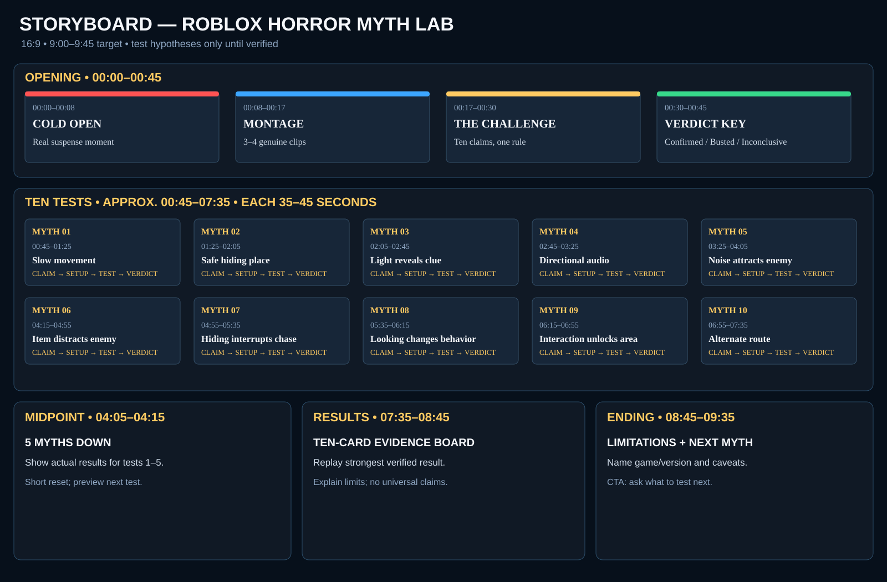
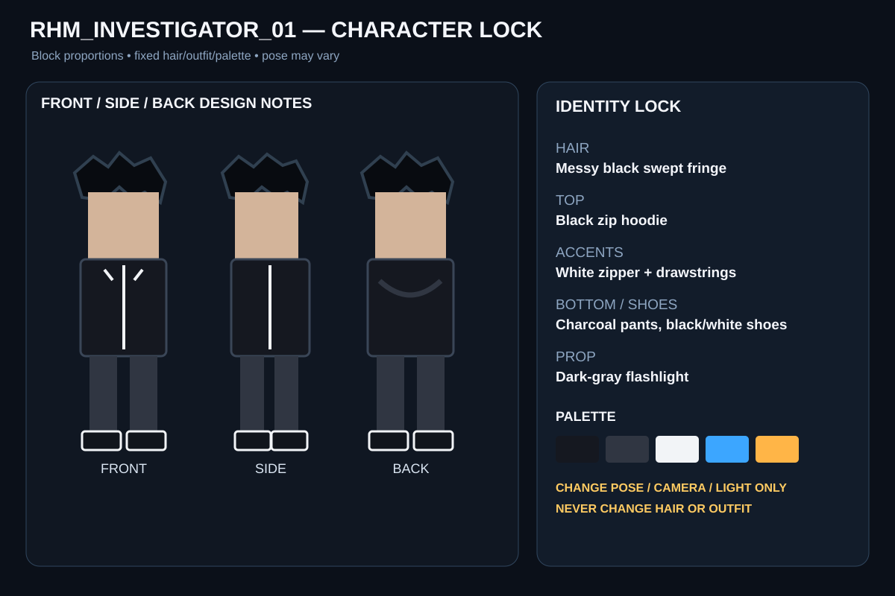

# Episode 01 — Roblox Horror Myth Lab

**Working title:** I Tested 10 Roblox Horror Myths to See Which Were Real  
**Format:** 16:9, 1920×1080, 30 fps, target 9:00–9:45  
**Editorial promise:** Every myth gets a visible test and an honest verdict. Never script an outcome before recording evidence.

> Critical: the ten entries below are hypotheses, not established facts. Choose the actual Roblox experience(s), record exact names/versions and test conditions, then assign verdicts only after reviewing footage. Generated illustrations are not gameplay evidence.

## Storyboard overview

## Character continuity

Use the same avatar in every illustration: Roblox-inspired blocky investigator; messy black swept-fringe hair with three recognizable tufts; black zip hoodie with white zipper and drawstrings; charcoal pants; black-and-white chunky sneakers; compact dark-gray flashlight. Keep proportions, hair silhouette, outfit, and palette fixed. In gameplay, capture the same avatar/outfit if the selected experience permits it.

## Timecoded storyboard

| Time | Beat | Visual direction | Narration / on-screen text | Edit / audio |
|---|---|---|---|---|
| 00:00–00:08 | Cold open | Strongest genuine recorded moment; punch-in, then hold on evidence. Use a temporary placeholder if footage is missing. | “Roblox horror is full of myths. Ten claims. One rule: we test them instead of taking them on faith.” On-screen: REAL OR FAKE? | Cold hit, low drone, no long logo intro. |
| 00:08–00:17 | Promise montage | 3–4 fast cuts from actual tests, no spoilers for every result. | “Some sound obvious. Others could change how you survive.” | Tight cuts, restrained whooshes. |
| 00:17–00:30 | Challenge setup | Investigator beside ten numbered cards. | Explain setup, attempt, evidence, verdict. | Establish music pulse. |
| 00:30–00:45 | Verdict key | Three cards: green CONFIRMED, red BUSTED, amber INCONCLUSIVE. | Define each verdict and evidence standard. | Short stingers; readable for at least 2 seconds. |
| 00:45–01:25 | Myth 1: slow movement | Show named game, enemy, route and controlled conditions; compare slow vs normal movement. | Does slow movement reduce enemy detection? Verdict follows captured evidence. | Keep game audio; annotate replay. |
| 01:25–02:05 | Myth 2: hiding safety | Show hiding spot, enemy departure, and what happens afterward. | Is a hiding place safe after the enemy leaves? | Build tension; lower music during evidence. |
| 02:05–02:45 | Myth 3: light reveals clues | Before/after views of the same room and conditions. | Can a light source reveal a hidden clue? | Flashlight sweep; never fabricate a clue. |
| 02:45–03:25 | Myth 4: directional audio | Compare sound direction against a visible source or repeatable event. | Can audio reliably reveal danger direction? | Duck BGM and preserve game audio. |
| 03:25–04:05 | Myth 5: noise attracts enemies | Quiet vs noisy comparison with other variables held stable. | Does running or noise attract an enemy? | Split-screen only when attempts are comparable. |
| 04:05–04:15 | Midpoint reset | Results board with first five actual verdicts only. | “Five tests down. The next ones get stranger—but we still need proof.” | Brief musical lift. |
| 04:15–04:55 | Myth 6: distraction | Test the specific item/sound and observe the enemy over a defined window. | Can an item or sound distract an enemy? | Show conditions, then replay. |
| 04:55–05:35 | Myth 7: chase interruption | Capture chase state before and after hiding; distinguish delay from escape. | Can hiding interrupt an active chase? | Fast chase cuts, slower evidence replay. |
| 05:35–06:15 | Myth 8: looking at enemy | Controlled gaze vs no-gaze comparison, if game allows it. | Does looking at an enemy change its behavior? | Gaze indicator; avoid causal claims from one uncontrolled run. |
| 06:15–06:55 | Myth 9: secret interaction | Show prerequisites, full interaction and resulting access. | Can a specific interaction unlock a secret area? | No “secret found” claim unless the footage proves it. |
| 06:55–07:35 | Myth 10: alternate route | Map the alternate route and show whether it bypasses danger. | Can an alternate route bypass a dangerous encounter? | Higher stakes, authentic gameplay only. |
| 07:35–08:10 | Results board | Ten-card grid with evidence-linked verdicts and caveats. | Summarize only supported outcomes. | Hold long enough to read. |
| 08:10–08:45 | Best finding | Replay the most surprising verified test, or the most useful if none is surprising. | Explain why it matters and what it does not prove. | Freeze-frame and 1–2 callouts. |
| 08:45–09:15 | Limitations | Show game/version, number of attempts, and uncontrolled variables. | “This is what we observed in this experience—not a universal rule for every Roblox horror game.” | Music down; honest and direct. |
| 09:15–09:35 | CTA | Investigator points toward two empty next-video cards. | “Which myth should we test next? Leave the claim and game below.” | Clean end screen. |

The timecodes are an edit map, not a reason to rush evidence. Extend tests or reduce the number if fair testing takes longer.

## Repeatable 40-second experiment structure

1. Claim (0–5s): one clear question.
2. Setup (5–12s): game name/version, conditions, and what counts as success.
3. Attempt (12–25s): minimally edited evidence.
4. Replay (25–33s): highlight the relevant moment without changing its meaning.
5. Verdict (33–40s): confirmed, busted, or inconclusive plus one-sentence reason.

## Experiment register

| # | Hypothesis | Required evidence | Status |
|---|---|---|---|
| 1 | Slow movement reduces enemy detection | Comparable slow/normal attempts under similar conditions | Pending |
| 2 | A hiding place remains safe after the enemy leaves | Full departure and post-departure observation | Pending |
| 3 | A light source reveals a hidden clue | Before/after views under the same conditions | Pending |
| 4 | Audio reliably indicates danger direction | Repeatable sound source and visible ground truth | Pending |
| 5 | Running/noise attracts an enemy | Quiet vs noisy comparison; other variables controlled | Pending |
| 6 | An item/sound distracts an enemy | Exact item use and observable response | Pending |
| 7 | Hiding interrupts a chase | Chase state before/after hiding; delay vs escape distinguished | Pending |
| 8 | Looking at an enemy changes behavior | Controlled gaze vs no-gaze comparison | Pending |
| 9 | A specific interaction unlocks a secret area | Prerequisites, interaction, and resulting access recorded | Pending |
| 10 | An alternate route bypasses danger | Route footage and evidence the encounter was bypassed | Pending |

## Thumbnail direction

- A / Main: investigator foreground, generic red-eyed shadow behind, flashlight beam, large text “10 HORROR MYTHS”.
- B / Alternate: investigator between green check and red X, text “REAL OR FAKE?”.
- C / Alternate: investigator facing an ominous door, text “SECRET FOUND?” only if the final video truly investigates a secret.

Avoid tiny text, ten miniature screenshots, fake reactions, and claims not supported by the final edit.

## Production checklist

- [ ] Choose actual Roblox experience(s), record exact names/versions.
- [ ] Capture clean 16:9 gameplay with relevant UI and audio.
- [ ] Record hypothesis, conditions, and attempt number for each test.
- [ ] Preserve uncut evidence; create edit copies separately.
- [ ] Use generated art only for illustration, transitions, and thumbnails.
- [ ] Write final narration after updating the evidence register.
- [ ] Generate subtitles from final narration and verify timing.
- [ ] Export 1920×1080 H.264, 30 fps; inspect beginning, middle, and end.
- [ ] Create three thumbnail variants and inspect mobile legibility.
- [ ] Verify title/thumbnail promises match actual findings.
